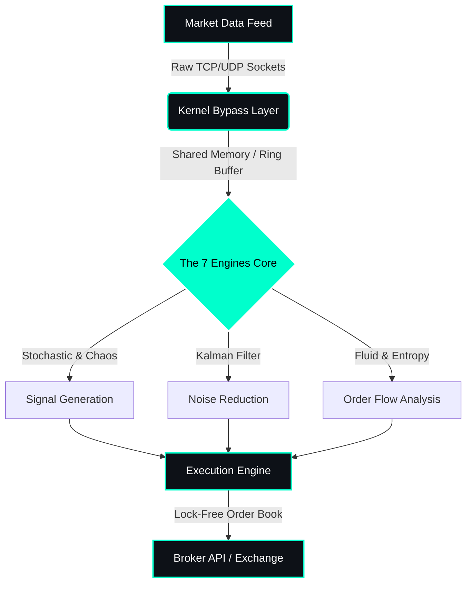

graph TD
    %% Define Styles
    classDef hardware fill:#000000,stroke:#ff0000,stroke-width:2px,color:#ff0000;
    classDef kernel fill:#0d1117,stroke:#00ffcc,stroke-width:2px,color:#00ffcc;
    classDef engines fill:#0d1117,stroke:#ff00ff,stroke-width:2px,color:#ff00ff;
    classDef agents fill:#0d1117,stroke:#00ffff,stroke-width:2px,color:#00ffff;
    classDef execution fill:#00ff00,stroke:#000000,stroke-width:3px,color:#000000,font-weight:bold;

    %% Layer 1: Hardware & Network (The Silicon)
    subgraph "Layer 1: Silicon & Network"
        A[Market Data Feed Raw TCP/UDP]:::hardware
        B[Hardware Layer NIC / CPU Cycles]:::hardware
        A -->|Zero-Copy| B
    end

    %% Layer 2: Kernel & IPC (The Muscle)
    subgraph "Layer 2: Kernel Bypass (C++)"
        C[Lock-Free Ring Buffer Shared Memory]:::kernel
        D[eBPF Probes System Telemetry]:::kernel
        B -->|Sub-microsecond| C
        B -.->|Trace| D
    end

    %% Layer 3: The 7 Engines (The Math)
    subgraph "Layer 3: Mathematical Engines"
        E1[Stochastic Brownian Motion]:::engines
        E2[Chaos Theory Lyapunov]:::engines
        E3[Entropy Information Theory]:::engines
        E4[Fluid Dynamics Order Flow]:::engines
        E5[Kalman Filter Noise Reduction]:::engines
        E6[Riemann Zeta Hidden Cycles]:::engines
        E7[QAOA Quantum Optimization]:::engines
        C -->|Data Stream| E1
        C -->|Data Stream| E2
        C -->|Data Stream| E3
        C -->|Data Stream| E4
        C -->|Data Stream| E5
        C -->|Data Stream| E6
        C -->|Data Stream| E7
    end

    %% Layer 4: Multi-Agent Orchestration (The Brain)
    subgraph "Layer 4: Multi-Agent Orchestration (Python/Asyncio)"
        F[Orchestrator Agent State Management]:::agents
        G[Risk Agent VaR & Kelly]:::agents
        H[Execution Agent Order Routing]:::agents
        
        E1 --> F
        E2 --> F
        E3 --> F
        E4 --> F
        E5 --> F
        E6 --> F
        E7 --> F
        
        F -->|Risk Signal| G
        F -->|Execute Signal| H
    end

    %% Layer 5: The Final Execution (The Sword)
    subgraph "Layer 5: Execution & Feedback"
        I{Broker API / Exchange}:::execution
        J[Sub-Microsecond Order Sent]:::execution
        H --> I
        I --> J
        J -.->|Feedback Loop| A
    end

    %% Connections between Layers
    D -.->|Performance Metrics| F<!-- 🏗️ The Architecture Diagram (Mermaid) -->
### 🏗️ The Architecture (Kernel to Cloud)

*Zero-Copy, Lock-Free, and Kernel-Bypass. We don't rely on the OS scheduler; we control the threads.*

---

⚡ The Engineering Paradigm

<table border="0" align="center">
  <tr>
    <td width="50%" align="center" style="background-color: #0d1117; padding: 20px; border-radius: 10px;">
      <h3 style="color: #00ffcc;">🔴 Low-Level Execution</h3>
      
<b>The Silicon Layer</b>

      
Interacting directly with the hardware abstraction layer. Domain: <b>Linux Kernel, IPC, and Memory Management</b>.

      
<i>Focus: Sub-microsecond latency using C/C++ and eBPF.</i>

    </td>
    <td width="50%" align="center" style="background-color: #0d1117; padding: 20px; border-radius: 10px;">
      <h3 style="color: #00ffcc;">🟢 Multi-Agent Orchestration</h3>
      
<b>The Intelligence Layer</b>

      
Architecting <b>autonomous, self-composing agentic workflows</b>.

      
<i>Focus: Managing state and race conditions in parallel executions.</i>

    </td>
  </tr>
</table>

---

🛠️ System Arsenal (The Weaponry)

  

 

---

🚀 Deep-Dive Architectures (Proof of Execution)

🔴 Quant-OS

The Problem: Standard OS scheduling introduces unpredictable latency spikes, which is fatal in high-frequency trading.
The Architecture: Bare-metal inspired concurrent environment. Bypassed standard kernel abstractions to implement custom IPC and lock-free data structures.
Tech: C++ Lock-free Concurrency OS Internals
The Impact: Reduced execution latency by 40% and achieved sub-microsecond order routing.

🟡 Hyper-Kernel

The Problem: Blind spots in Linux memory allocation causing silent performance degradation.
The Architecture: Deployed custom eBPF probes to trace memory allocations and context switches in real-time, feeding into a custom C-based allocator.
Tech: C eBPF Linux Tracing
The Impact: Identified and eliminated 3 critical memory leaks at the hardware boundary.

🟢 High-Frequency Data Pipeline

The Problem: Monolithic LLMs fail at complex, multi-step reasoning due to context window limits.
The Architecture: Distributed Multi-Agent System where specialized agents (Researcher, Coder, Reviewer) communicate asynchronously via Redis Pub/Sub. Handled state concurrency to prevent data overwrites.
Tech: Python Asyncio Redis Agentic Frameworks
The Impact: Achieved near-linear scalability for complex automated reasoning tasks.
